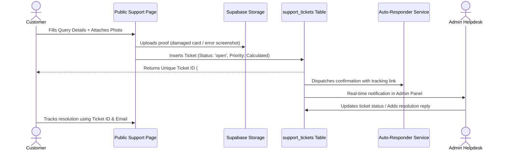
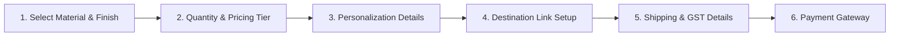
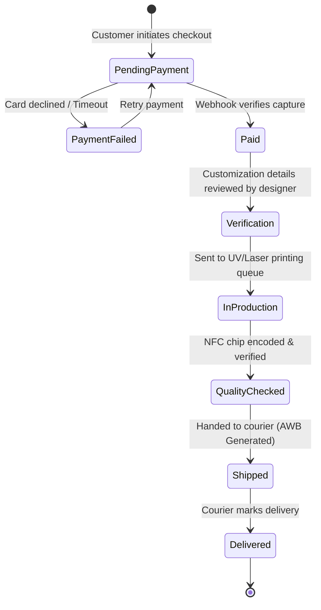

# TapFlow — Smart QR & NFC Card Ecosystem
## Complete System Architecture & End-to-End Flow Design Document

> **Document Type:** System Architecture & UX/Data Flow Specification  
> **Target Platform:** TapFlow (Smart QR & NFC Business Cards, Standees, Dynamic Digital Profiles)  
> **Stack Alignment:** React (Vite) + Tailwind CSS + Supabase (PostgreSQL / RLS / Storage) + Payment Gateways (Razorpay / Stripe)  
> **Status:** Approved for Implementation Planning (No Source Code Changes Applied)

---

## 1. Executive Summary & Business Architecture

**TapFlow** is a modern hardware + software platform providing smart dynamic networking tools:
1. **NFC & QR Business Cards** (Matte PVC, Brushed Metal, Bamboo Wood).
2. **Contactless Smart Standees** (Acrylic tabletop stands for restaurants, shops, and corporate desks).
3. **Dynamic QR Engine** (Users can update their landing URL, vCard, social profile anytime without changing the physical card or re-printing).

### Business Requirements Addressed in this Design:
- **Public Website Navigation:** Clean, modern header with **Home**, **About**, **Products**, **Contact**, **Support**, and quick Action CTAs.
- **Card Ordering Experience:** End users can browse products, configure quantity with dynamic bulk tier pricing, enter personal/corporate branding details (logo, name, destination URL), and make secure payments.
- **Support & Query Helpdesk:** Tailored specifically to NFC/QR hardware & software issues (chip read issues, print quality, redirection, updates) with ticket generation (`#TKT-XXXX`) and tracking.
- **Admin Product Catalog Management:** Admins can create, update, price, and publish physical products from the Admin Panel, instantly reflecting on the customer-facing website.
- **Order Pipeline ("Website to Admin Panel"):** When an order is placed on the website, it instantly appears in the Admin Panel with full customization assets (uploaded logos, engraving text, destination links) and an order management state machine (Pending -> Paid -> In Production -> Shipped -> Delivered).
- **Payment Gateway Configuration:** Secure Admin Panel settings module allowing administrators to toggle payment gateways (Razorpay, Stripe, Cashfree), switch between Test/Live modes, input API keys, and configure webhooks.

---

## 2. High-Level System Architecture & Flowchart

```mermaid
graph TD
    subgraph Public Website
        NAV[Navigation Bar: Home | About | Products | Contact | Support]
        PROD_PAGE[Products Page /products]
        CUSTOMIZE[Card Customization & Bulk Quantity Selector]
        CHECKOUT[Checkout & Payment Modal]
        SUPPORT_PAGE[Support Helpdesk /support]
        CONTACT_PAGE[Business Inquiries /contact]
    end

    subgraph Payment Infrastructure
        GATEWAY[Payment Gateway: Razorpay / Stripe]
        WEBHOOK[Payment Webhook Handler]
    end

    subgraph Supabase Backend
        DB_PRODUCTS[(products)]
        DB_ORDERS[(orders & order_items)]
        DB_SUPPORT[(support_tickets)]
        DB_CONFIG[(payment_gateway_configs)]
        STORAGE[(Supabase Storage: Logos & Attachments)]
        REALTIME[Supabase Realtime Engine]
    end

    subgraph Admin Panel
        ADMIN_PROD[Manage Products /admin/products]
        ADMIN_ORDERS[Live Orders Board /admin/orders]
        ADMIN_SUPPORT[Support Ticket Desk /admin/support]
        ADMIN_PAYMENT[Payment Gateway Config /admin/settings/payment]
    end

    %% Flow connections
    NAV --> PROD_PAGE
    NAV --> SUPPORT_PAGE
    NAV --> CONTACT_PAGE

    ADMIN_PROD -->|Create/Update Products| DB_PRODUCTS
    DB_PRODUCTS -->|Catalog Feed| PROD_PAGE

    PROD_PAGE --> CUSTOMIZE
    CUSTOMIZE --> CHECKOUT
    CHECKOUT -->|Initiate Order| GATEWAY
    GATEWAY -->|Payment Confirmation| WEBHOOK
    WEBHOOK -->|Record Order + Customization| DB_ORDERS
    CUSTOMIZE -->|Upload Logo| STORAGE

    SUPPORT_PAGE -->|Submit Query + Photos| DB_SUPPORT
    SUPPORT_PAGE -->|Upload Screenshot| STORAGE

    DB_ORDERS -->|Realtime Notification| ADMIN_ORDERS
    DB_SUPPORT -->|Realtime Notification| ADMIN_SUPPORT

    ADMIN_PAYMENT -->|Save API Keys & Webhooks| DB_CONFIG
    DB_CONFIG -.->|Active Gateway Keys| CHECKOUT
```

---

## 3. Public Navigation & Information Architecture

### 3.1 Website Header Navigation

The top navigation bar is updated across desktop and mobile to present a cohesive journey:

| Nav Item | Route | Purpose & Description |
| :--- | :--- | :--- |
| **Home** | `/` | Hero section, interactive NFC/QR previewer, feature highlights, client testimonials, founder story. |
| **About** | `/#about` or `/about` | Mission, technological edge (NTAG216 high memory, AES encryption, UV printing durability). |
| **Products** | `/products` | Dynamic catalog of physical NFC cards, standees, epoxy tags, and corporate bundles. |
| **Contact** | `/contact` | Business partnerships, custom enterprise quotes, physical office details, WhatsApp hotline. |
| **Support** | `/support` | Specialized helpdesk for card troubleshooting, ticket logging, and query status tracking. |
| **Update Card** (CTA) | `/update` | Direct self-service portal for existing cardholders to update their destination link using QR + Password. |
| **Order Now** (Primary CTA) | `/products` | Prominent vibrant button highlighting "Order Smart Card" to maximize conversions. |

---

## 4. Customer Support System Architecture (`/support`)

### 4.1 Specialized Domain-Specific Categories
General contact forms fail for NFC/QR businesses because support tickets require specific hardware and software context. The `/support` form categorizes issues into:

1. **NFC Hardware & Scanning:**
   - "Phone does not detect NFC tap" (antenna placement / OS settings guide).
   - "Physical card damaged or scratched".
2. **Dynamic QR & Redirection:**
   - "QR code points to wrong URL or 404".
   - "Cannot update destination link / Forgot card password".
3. **Order & Shipping Status:**
   - "Order delayed / Need courier tracking number".
   - "Received incorrect quantity or custom name spelling error".
4. **Bulk / Enterprise Assistance:**
   - "Need customized CSV upload or employee badge batch generation".
5. **Billing & Invoices:**
   - "Need GST tax invoice or payment receipt".

### 4.2 Support Form Data Structure



#### Ticket Fields:
- **Full Name** *(Required)*
- **Email Address** *(Required, used for notifications & ticket lookup)*
- **Phone / WhatsApp Number** *(Required for urgent dispatch updates)*
- **Issue Category** *(Select dropdown: NFC Tap Issue, QR Redirection, Order Tracking, Print Defect, Password Reset, Other)*
- **Associated Identifier:**
  - *Card / Standee QR Number* (e.g. `TF-10042` — validates against `qr_codes` table if applicable)
  - *Order Number* (e.g. `ORD-8921` — validates against `orders` table if applicable)
- **Subject** *(Brief summary, e.g. "Card laser engraving name has typo")*
- **Detailed Message** *(Multi-line description of the issue)*
- **Attachments** *(Image/PDF upload: photos of the physical card, scanner error screen, or invoice)*
- **Urgency Level** *(Low, Normal, Urgent)*

### 4.3 Ticket Self-Tracking Portal (`/support/track`)
Customers do not need to log in to track their queries:
- Enter **Ticket ID** (e.g., `#TKT-82910`) + **Email Address**.
- Displays current status: `Open`, `Under Investigation`, `Replacement Dispatched`, or `Resolved`.
- Displays the complete conversation timeline with admin notes and resolution details.

---

## 5. Card Ordering & Product Showcase Flow (`/products` & `/order`)

### 5.1 Dynamic Product Catalog (`/products`)
The catalog is dynamically populated from the `products` table in Supabase (managed via Admin Panel):

#### Product Lineup:
1. **TapFlow Matte PVC Smart Card:** Water-resistant, high-durability polymer with embedded NTAG216 chip + high-contrast QR.
2. **TapFlow Luxury Metal NFC Card:** Laser-engraved stainless steel (Matte Black, Brushed Gold, Titanium Grey) with hybrid ceramic backing for instant RF transmission.
3. **TapFlow Eco Bamboo/Wood Card:** Sustainable natural bamboo with laser-etched branding and NFC core.
4. **TapFlow Contactless Acrylic Standee:** Countertop display stand with double-sided QR + NFC tap pad for retail counters and Google Review collection.
5. **TapFlow Epoxy Phone Tag / Keychain:** Miniature adhesive NFC tag for quick tap sharing on smartphones.

### 5.2 Dynamic Quantity & Bulk Tier Discount Engine

Smart cards have substantial production economies of scale. The order module automatically applies tiered discounts:

| Quantity Range | Discount | Price Per Card (Matte PVC Example) | Target Audience |
| :--- | :--- | :--- | :--- |
| **1 – 4 Cards** | Standard (0%) | ₹499 / card | Individual Freelancers & Executives |
| **5 – 19 Cards** | 15% OFF | ₹424 / card | Small Teams & Startups |
| **20 – 49 Cards** | 25% OFF | ₹374 / card | Growing Businesses & Events |
| **50+ Cards** | 35% OFF + Free Logo Engraving | ₹324 / card | Corporate Enterprises & Agencies |

### 5.3 Card Customization Specification Flow

When a user selects "Customize & Order", an interactive customization wizard opens:



#### Customization Attributes Captured:
1. **Cardholder Name:** Text to be printed or laser-engraved on the front (e.g. "Dr. Sarah Jenkins").
2. **Company / Subtitle:** (e.g. "Chief Innovation Officer | Nexa Labs").
3. **Logo Upload:** High-resolution PNG, SVG, or PDF (stored directly in Supabase Storage bucket `order-assets`).
4. **Initial Destination URL / Digital Profile:**
   - Option A: Direct URL (e.g., `https://linkedin.com/in/sarahjenkins` or company website).
   - Option B: Generate TapFlow Digital Profile (interactive vCard with phone, email, WhatsApp, socials).
5. **Card Base Color / Finish:** Matte Jet Black, Frosted White, Brushed Gold, Natural Bamboo.
6. **Card Layout Selection:**
   - *Minimalist:* Logo center + Name bottom left + Tap icon top right.
   - *Dual Front/Back:* Logo & Name on front; Dynamic QR code + instructions on back.

---

## 6. Admin Panel: Product Management (`/admin/products`)

### 6.1 Admin Product Capabilities
Admins can fully control what products appear on the public website without editing code:

- **Create New Product:**
  - Product Name (e.g. "TapFlow Luxury Metal Card")
  - Slug (auto-generated, e.g. `luxury-metal-card`)
  - Description & Selling Points (bullet points)
  - Category (`Cards`, `Standees`, `Tags`, `Accessories`)
  - Base Retail Price (₹) & Optional Discounted Sale Price (₹)
  - Bulk Pricing Tiers (JSON structure for tiered discounts)
  - Material Specifications (Stainless Steel 0.8mm, Bamboo 1.2mm, PVC 0.76mm)
  - NFC Chip Specification (NTAG213: 144 bytes, NTAG215: 504 bytes, NTAG216: 888 bytes)
  - Image Gallery (Primary thumbnail + secondary detail photos)
  - Customization Rules:
    - Allow Logo Upload: `true` / `false`
    - Allow Front Name Engraving: `true` / `false`
    - Allow Custom Color Choice: `true` / `false`
  - Stock Status (`in_stock`, `low_stock`, `pre_order`, `discontinued`)
  - Visibility Toggle: `Active` (visible on website) / `Draft` (hidden)

### 6.2 Instant Public Sync
Changes saved in `/admin/products` are committed to the `products` table in Supabase. The public `/products` page queries this table, meaning newly listed products, price adjustments, or out-of-stock badges are reflected instantly.

---

## 7. Order Processing Pipeline ("Website say Admin Panel tak")

### 7.1 Order Lifecycle State Machine



### 7.2 What the Admin Sees in `/admin/orders`
When an order is placed on the website:
1. **Real-time Badge Notification:** Admin header reflects +1 new pending order.
2. **Order Summary Card / Table Row:**
   - **Order ID:** `#ORD-9042`
   - **Customer:** Name, Email, Phone, Shipping Address.
   - **Order Value:** Total amount, Payment status (`Paid` via Razorpay / Stripe with Gateway Transaction ID).
   - **Items Ordered:**
     - Product Name, Material & Finish, Quantity.
     - **Card Personalization Data:**
       - Cardholder Name: "Alex Rivera"
       - Company: "Apex Design Studio"
       - Destination URL: `https://tapflow.app/q/TF-8091`
       - Downloadable Logo Asset (click to download high-resolution vector/PNG).
3. **Operational Actions for Admin:**
   - **Download Production Spec Sheet (PDF):** Auto-generated print sheet for the manufacturing team with artwork dimensions and vector logo.
   - **Generate Linked QR Numbers:** Admin can automatically assign pre-created QR codes from the `qr_codes` table to this order.
   - **Update Order Status:** Dropdown to change status (`Paid` -> `In Production` -> `Shipped` -> `Delivered`).
   - **Courier Tracking Integration:** Admin enters Courier Name (e.g. BlueDart, Delhivery, FedEx) and AWB Tracking Number, triggering an automated email/SMS to the customer with live tracking link.

---

## 8. Admin Panel: Payment Gateway Configuration (`/admin/settings/payment`)

### 8.1 Dedicated Gateway Configuration Screen
A secure settings page in the Admin Panel enables administrators to configure and switch payment gateways without modifying application code or redeploying the app.

```
+--------------------------------------------------------------------------+
|  PAYMENT GATEWAY CONFIGURATION                                            |
|  Configure active payment provider, credentials, and webhook endpoints  |
+--------------------------------------------------------------------------+
|                                                                          |
|  Active Gateway Provider:  [ Razorpay  v ]   (Options: Razorpay, Stripe) |
|  Environment Mode:         ( ) Test / Sandbox    (*) Live / Production   |
|                                                                          |
|  ----------------------------------------------------------------------  |
|  RAZORPAY CREDENTIALS                                                    |
|  ----------------------------------------------------------------------  |
|  Key ID (Public):        [ rzp_live_xxxxxxxxxxxxxxxxxxxx              ]  |
|  Key Secret (Private):   [ ****************************************** ]  |
|  Webhook Secret:         [ whsec_xxxxxxxxxxxxxxxxxxxxxxxx            ]  |
|                                                                          |
|  ----------------------------------------------------------------------  |
|  TRANSACTION SETTINGS                                                    |
|  ----------------------------------------------------------------------  |
|  Currency:               [ INR (₹) v ]                                   |
|  Auto-Capture Payment:   [x] Automatically capture payment upon charge   |
|  Accepted Methods:       [x] UPI   [x] Cards   [x] NetBanking  [x] EMI   |
|                                                                          |
|  Webhook Endpoint URL:                                                   |
|  https://api.tapflow.app/api/webhooks/payment                            |
|  (Copy this URL into your Razorpay/Stripe Webhook Settings)               |
|                                                                          |
|  [ Test Connection ]                   [ Save Configuration Changes ]    |
+--------------------------------------------------------------------------+
```

### 8.2 Security Architecture for Payment Keys
- **Client Security:** The private API secret is **never** sent to the public browser.
- **Supabase Vault / Secure Table:** The credentials are stored in `payment_gateway_configs` with strict Row Level Security (RLS) allowing read/write **only** to authenticated administrators (`auth.uid() IN (SELECT id FROM admin_users)`).
- **Public Checkout Handshake:** The public website checkout only queries the `public_key` (e.g. `rzp_live_xxx` or `pk_live_xxx`) and currency. Order verification and secret-key signatures occur strictly via Supabase Edge Functions / Backend Webhooks.

---

## 9. Contact Page Architecture (`/contact`)

### 9.1 Purpose & Enterprise Focus
While `/support` handles existing customers and technical queries, `/contact` focuses on:
- **Corporate & Enterprise Inquiries:** Companies ordering 50+ branded cards for sales teams.
- **White-Label & Agency Reseller Partnerships:** Agencies reselling TapFlow cards to their clients.
- **Physical Office & Studio Contact:** Address, Google Maps embed, phone lines, and email.

### 9.2 Contact Form Specifications
- **Full Name & Corporate Email**
- **Company Name & Size** (1-10, 11-50, 50-250, 250+ employees)
- **Interest Type:**
  - Corporate Bulk NFC Cards
  - Custom Branded Standees for Events / Retail
  - White-Label Portal & Reseller Program
  - Press / General Partnership
- **Estimated Quantity:** Slider / input (e.g., 25, 100, 500+)
- **Message / Specific Customization Requests**
- **Direct Reach-Out Panel:**
  - WhatsApp Business Chat Link (one-click launch)
  - Dedicated Enterprise Email: `enterprise@tapflow.app`
  - Support Escalation Email: `support@tapflow.app`
  - Studio Location & Operating Hours (Mon-Sat 9:30 AM - 6:30 PM IST)

---

## 10. Database Schema Design (PostgreSQL / Supabase DDL)

Here is the production-ready schema to support Products, Orders, Support Tickets, and Payment Gateways alongside the existing `qr_codes` and `batches` tables:

```sql
-- ==============================================================================
-- 1. PRODUCTS TABLE (Managed via Admin Panel, displayed on /products)
-- ==============================================================================
CREATE TABLE IF NOT EXISTS public.products (
    id UUID PRIMARY KEY DEFAULT gen_random_uuid(),
    title TEXT NOT NULL,
    slug TEXT NOT NULL UNIQUE,
    short_description TEXT,
    full_description TEXT,
    category TEXT NOT NULL CHECK (category IN ('cards', 'standees', 'tags', 'accessories', 'bundles')),
    material TEXT NOT NULL, -- 'pvc', 'metal', 'bamboo_wood', 'acrylic'
    chip_type TEXT NOT NULL DEFAULT 'NTAG216', -- 'NTAG213', 'NTAG215', 'NTAG216'
    base_price NUMERIC(10, 2) NOT NULL,
    sale_price NUMERIC(10, 2),
    bulk_pricing_tiers JSONB DEFAULT '[
        {"min_qty": 1, "max_qty": 4, "discount_pct": 0},
        {"min_qty": 5, "max_qty": 19, "discount_pct": 15},
        {"min_qty": 20, "max_qty": 49, "discount_pct": 25},
        {"min_qty": 50, "max_qty": 9999, "discount_pct": 35}
    ]'::jsonb,
    images TEXT[] NOT NULL DEFAULT '{}',
    is_active BOOLEAN NOT NULL DEFAULT true,
    is_featured BOOLEAN NOT NULL DEFAULT false,
    stock_status TEXT NOT NULL DEFAULT 'in_stock' CHECK (stock_status IN ('in_stock', 'low_stock', 'pre_order', 'out_of_stock')),
    allow_logo_upload BOOLEAN NOT NULL DEFAULT true,
    allow_custom_name BOOLEAN NOT NULL DEFAULT true,
    created_at TIMESTAMPTZ NOT NULL DEFAULT now(),
    updated_at TIMESTAMPTZ NOT NULL DEFAULT now()
);

-- ==============================================================================
-- 2. ORDERS TABLE (Created on Website, managed in Admin Panel)
-- ==============================================================================
CREATE TABLE IF NOT EXISTS public.orders (
    id UUID PRIMARY KEY DEFAULT gen_random_uuid(),
    order_number TEXT NOT NULL UNIQUE, -- e.g. 'ORD-2026-1042'
    customer_name TEXT NOT NULL,
    customer_email TEXT NOT NULL,
    customer_phone TEXT NOT NULL,
    shipping_address JSONB NOT NULL, -- { line1, line2, city, state, postal_code, country }
    gstin TEXT, -- Optional business tax registration
    subtotal NUMERIC(10, 2) NOT NULL,
    discount_amount NUMERIC(10, 2) NOT NULL DEFAULT 0.00,
    shipping_fee NUMERIC(10, 2) NOT NULL DEFAULT 0.00,
    tax_amount NUMERIC(10, 2) NOT NULL DEFAULT 0.00,
    total_amount NUMERIC(10, 2) NOT NULL,
    currency TEXT NOT NULL DEFAULT 'INR',
    payment_status TEXT NOT NULL DEFAULT 'pending' CHECK (payment_status IN ('pending', 'paid', 'failed', 'refunded')),
    payment_gateway TEXT NOT NULL DEFAULT 'razorpay', -- 'razorpay', 'stripe', 'cashfree'
    payment_transaction_id TEXT,
    order_status TEXT NOT NULL DEFAULT 'pending_verification' CHECK (
        order_status IN ('pending_verification', 'in_production', 'quality_checked', 'shipped', 'delivered', 'cancelled')
    ),
    courier_partner TEXT,
    courier_tracking_number TEXT,
    courier_tracking_url TEXT,
    admin_internal_notes TEXT,
    created_at TIMESTAMPTZ NOT NULL DEFAULT now(),
    updated_at TIMESTAMPTZ NOT NULL DEFAULT now()
);

-- ==============================================================================
-- 3. ORDER ITEMS TABLE (Contains individual card customization specs)
-- ==============================================================================
CREATE TABLE IF NOT EXISTS public.order_items (
    id UUID PRIMARY KEY DEFAULT gen_random_uuid(),
    order_id UUID NOT NULL REFERENCES public.orders(id) ON DELETE CASCADE,
    product_id UUID REFERENCES public.products(id) ON DELETE SET NULL,
    product_title TEXT NOT NULL,
    quantity INTEGER NOT NULL DEFAULT 1,
    unit_price NUMERIC(10, 2) NOT NULL,
    total_price NUMERIC(10, 2) NOT NULL,
    
    -- Customization specifics per card batch
    cardholder_name TEXT,
    company_name TEXT,
    uploaded_logo_url TEXT,
    custom_color_finish TEXT,
    destination_url TEXT,
    assigned_qr_numbers TEXT[], -- Array of assigned QR codes from qr_codes table
    created_at TIMESTAMPTZ NOT NULL DEFAULT now()
);

-- ==============================================================================
-- 4. SUPPORT TICKETS TABLE (Submitted on /support, managed in Admin Panel)
-- ==============================================================================
CREATE TABLE IF NOT EXISTS public.support_tickets (
    id UUID PRIMARY KEY DEFAULT gen_random_uuid(),
    ticket_number TEXT NOT NULL UNIQUE, -- e.g. 'TKT-78291'
    customer_name TEXT NOT NULL,
    customer_email TEXT NOT NULL,
    customer_phone TEXT,
    category TEXT NOT NULL CHECK (
        category IN ('nfc_hardware', 'qr_redirect', 'order_status', 'print_defect', 'password_reset', 'bulk_inquiry', 'general')
    ),
    associated_qr_number TEXT,
    associated_order_number TEXT,
    subject TEXT NOT NULL,
    description TEXT NOT NULL,
    attachment_urls TEXT[] DEFAULT '{}',
    status TEXT NOT NULL DEFAULT 'open' CHECK (status IN ('open', 'in_progress', 'waiting_customer', 'resolved', 'closed')),
    priority TEXT NOT NULL DEFAULT 'medium' CHECK (priority IN ('low', 'medium', 'high', 'urgent')),
    assigned_admin_email TEXT,
    resolution_notes TEXT,
    created_at TIMESTAMPTZ NOT NULL DEFAULT now(),
    updated_at TIMESTAMPTZ NOT NULL DEFAULT now()
);

-- Ticket replies thread
CREATE TABLE IF NOT EXISTS public.ticket_replies (
    id UUID PRIMARY KEY DEFAULT gen_random_uuid(),
    ticket_id UUID NOT NULL REFERENCES public.support_tickets(id) ON DELETE CASCADE,
    sender_type TEXT NOT NULL CHECK (sender_type IN ('customer', 'admin')),
    sender_name TEXT NOT NULL,
    message TEXT NOT NULL,
    attachments TEXT[] DEFAULT '{}',
    created_at TIMESTAMPTZ NOT NULL DEFAULT now()
);

-- ==============================================================================
-- 5. PAYMENT GATEWAY CONFIGURATIONS TABLE (Configured in Admin Panel)
-- ==============================================================================
CREATE TABLE IF NOT EXISTS public.payment_gateway_configs (
    id UUID PRIMARY KEY DEFAULT gen_random_uuid(),
    provider TEXT NOT NULL UNIQUE, -- 'razorpay', 'stripe', 'cashfree'
    is_active BOOLEAN NOT NULL DEFAULT false,
    environment_mode TEXT NOT NULL DEFAULT 'test' CHECK (environment_mode IN ('test', 'live')),
    public_key TEXT NOT NULL,
    private_key_encrypted TEXT NOT NULL,
    webhook_secret TEXT,
    currency TEXT NOT NULL DEFAULT 'INR',
    auto_capture BOOLEAN NOT NULL DEFAULT true,
    enabled_payment_methods TEXT[] DEFAULT '{"upi", "cards", "netbanking"}',
    updated_by TEXT,
    updated_at TIMESTAMPTZ NOT NULL DEFAULT now()
);

-- High-Speed Indexes
CREATE INDEX IF NOT EXISTS idx_products_category ON public.products(category);
CREATE INDEX IF NOT EXISTS idx_products_is_active ON public.products(is_active);
CREATE INDEX IF NOT EXISTS idx_orders_customer_email ON public.orders(customer_email);
CREATE INDEX IF NOT EXISTS idx_orders_order_status ON public.orders(order_status);
CREATE INDEX IF NOT EXISTS idx_orders_payment_status ON public.orders(payment_status);
CREATE INDEX IF NOT EXISTS idx_support_tickets_status ON public.support_tickets(status);
CREATE INDEX IF NOT EXISTS idx_support_tickets_email ON public.support_tickets(customer_email);
CREATE INDEX IF NOT EXISTS idx_support_tickets_number ON public.support_tickets(ticket_number);
```

---

## 11. Screen-by-Screen UI/UX Specifications

### 11.1 Public Pages
1. **Header Navigation:**
   - Left: TapFlow Logo with hover subtle pulse.
   - Center: `Home`, `About`, `Products`, `Contact`, `Support`.
   - Right: "Update Card" (link to `/update`) + "Order Card" (electric-themed button leading to `/products`).
2. **Products Page (`/products`):**
   - Filter chips: All, Cards, Standees, Tags, Corporate Packs.
   - Product Grid: High-contrast 3D product renders, chip type badge (e.g. `NTAG216 | 888 Bytes`), base price, bulk discount pill (`Up to 35% OFF`), and "Customize & Buy" button.
3. **Card Customization & Checkout Modal / Page:**
   - Split view: Live interactive card preview on left (shows user's entered name, logo position, and finish) + customization form on right.
   - Instant calculation of bulk volume discount as quantity increments.
   - Razorpay / Stripe checkout popup on payment click.
4. **Support Helpdesk (`/support`):**
   - Two clear tabs: **Submit Support Query** and **Track Existing Ticket**.
   - Clean card-based form with category selector badges, QR number helper, image dropzone, and instant Ticket ID confirmation modal.
5. **Contact Page (`/contact`):**
   - Corporate sales quote calculator, direct WhatsApp launch button, studio office address, and contact form.

### 11.2 Admin Panel Pages
1. **Admin Sidebar Expansion:**
   - *Core QR Management:* Dashboard, Create QR, Bulk QR, Upload CSV, Manage QR.
   - *E-Commerce & Orders:*
     - **Products:** `/admin/products` (Product listing, edit pricing, toggle stock, manage tiers).
     - **Orders:** `/admin/orders` (View orders, see customer details, download uploaded logo, change order status, print manufacturing spec).
     - **Support Desk:** `/admin/support` (View open tickets, reply to customer, resolve tickets).
     - **Payment Settings:** `/admin/settings/payment` (Configure Razorpay/Stripe, Test/Live mode, API keys).
     - **Backup:** `/admin/backup`.

---

## 12. Implementation Plan & Next Steps (When Coding Begins)

When you are ready to begin coding this system, the implementation will proceed in four structured phases:

1. **Phase 1: Backend Database & Storage Setup**
   - Execute the SQL schema above in Supabase to create `products`, `orders`, `order_items`, `support_tickets`, `ticket_replies`, and `payment_gateway_configs`.
   - Create Supabase Storage buckets `order-assets` (logos) and `support-attachments` (photos).
2. **Phase 2: Public Navigation & Frontend Pages**
   - Update `Navbar.tsx` with `Home`, `About`, `Products`, `Contact`, `Support`.
   - Build `/products` with dynamic product catalog and customization wizard.
   - Build `/support` query submission & ticket lookup.
   - Build `/contact` corporate inquiry form.
3. **Phase 3: Admin Panel Modules**
   - Add routes and sidebar items in `AdminLayout.tsx` for Products, Orders, Support Desk, and Payment Settings.
   - Build `AdminProducts.tsx` (Add/Edit products, images, pricing tiers).
   - Build `AdminOrders.tsx` (Real-time order feed, customization specs, logo download, tracking numbers).
   - Build `AdminSupport.tsx` (Ticket triage, status updates, customer reply thread).
   - Build `AdminPaymentSettings.tsx` (Gateway selector, test/live toggles, key storage).
4. **Phase 4: Payment Handshake & Webhook Integration**
   - Implement frontend Razorpay checkout popup.
   - Implement Supabase webhook edge function to verify signature and automatically mark order as `paid` and trigger production alert.

---
*End of Design Specification Document — Prepared for TapFlow Smart QR Ecosystem.*
